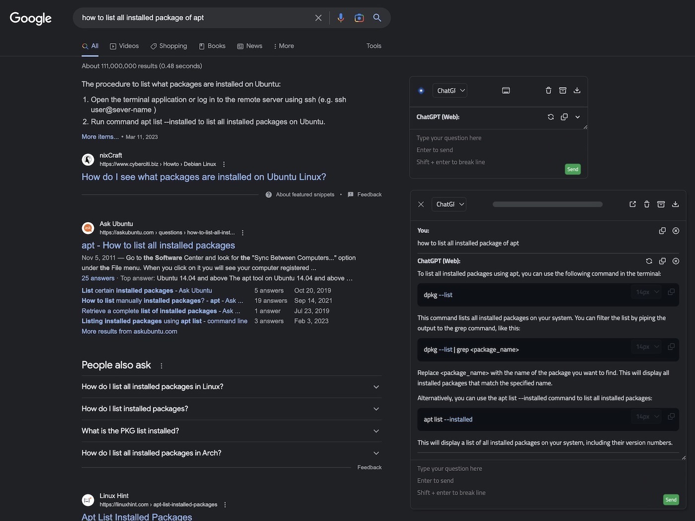
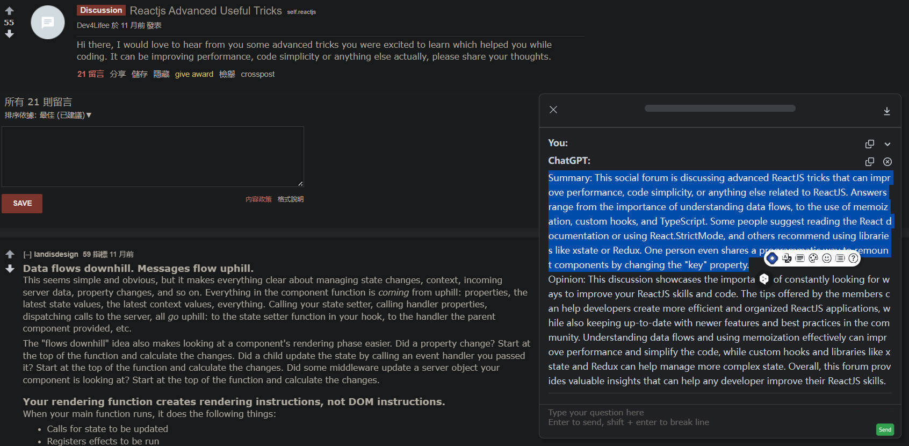
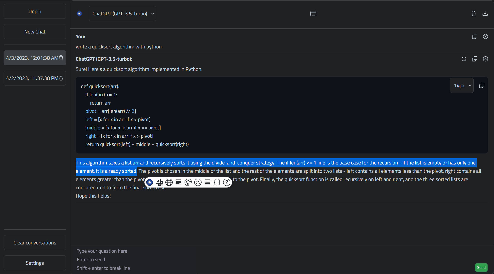
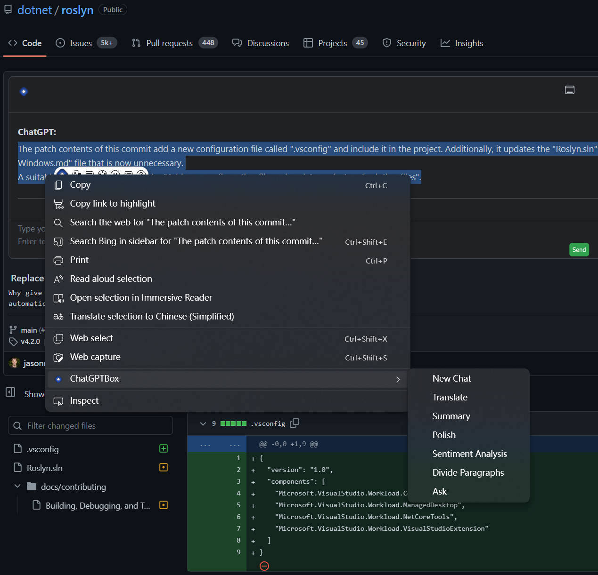
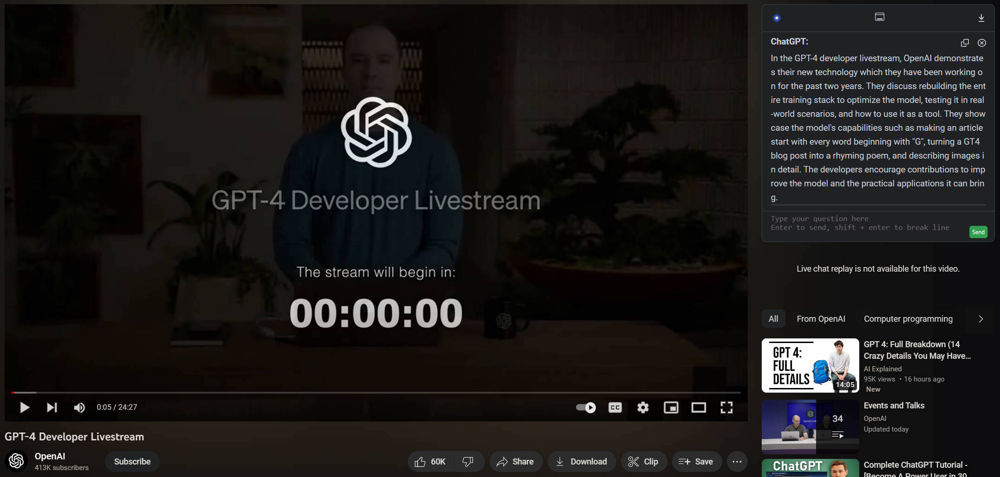
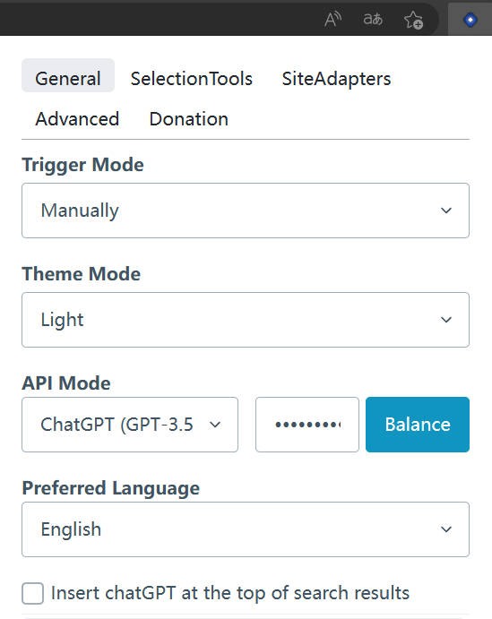

    

<h1 align="center">ChatGPT Box</h1>

本仓库基于 [ChatGPTBox](https://github.com/ChatGPTBox-dev/chatGPTBox)。下方安装链接和发布徽章指向上游项目。

将ChatGPT深度集成到浏览器中, 你所需要的一切均在于此

[![license][license-image]][license-url]
[![release][release-image]][release-url]

[English](README.md) &nbsp;&nbsp;|&nbsp;&nbsp; [Indonesia](README_IN.md) &nbsp;&nbsp;|&nbsp;&nbsp; 简体中文 &nbsp;&nbsp;|&nbsp;&nbsp; [日本語](README_JA.md) &nbsp;&nbsp;|&nbsp;&nbsp; [Türkçe](README_TR.md)

### 安装链接

[![Chrome][Chrome-image]][Chrome-url]
[![Edge][Edge-image]][Edge-url]
[![Firefox][Firefox-image]][Firefox-url]
[![Safari][Safari-image]][Safari-url]
[![Android][Android-image]][Android-url]
[![Github][Github-image]][Github-url]

[使用指南](https://github.com/ChatGPTBox-dev/chatGPTBox/wiki/Guide) &nbsp;&nbsp;|&nbsp;&nbsp; [效果预览](#preview) &nbsp;&nbsp;|&nbsp;&nbsp; [开发&贡献][dev-url] &nbsp;&nbsp;|&nbsp;&nbsp; [视频演示](https://www.bilibili.com/video/BV1524y1x7io) &nbsp;&nbsp;|&nbsp;&nbsp; [鸣谢](#credit)

[dev-url]: https://github.com/ChatGPTBox-dev/chatGPTBox/wiki/Development&Contributing

[license-image]: https://img.shields.io/badge/license-MIT-blue.svg

[license-url]: LICENSE

[release-image]: https://img.shields.io/github/release/ChatGPTBox-dev/chatGPTBox.svg

[release-url]: https://github.com/ChatGPTBox-dev/chatGPTBox/releases/latest

[Chrome-image]: https://img.shields.io/badge/-Chrome-brightgreen?logo=google-chrome&logoColor=white

[Chrome-url]: https://chrome.google.com/webstore/detail/chatgptbox/eobbhoofkanlmddnplfhnmkfbnlhpbbo

[Edge-image]: https://img.shields.io/badge/-Edge-blue?logo=microsoft-edge&logoColor=white

[Edge-url]: https://microsoftedge.microsoft.com/addons/detail/fission-chatbox-best/enjmfilpkbbabhgeoadmdpjjpnahkogf

[Firefox-image]: https://img.shields.io/badge/-Firefox-orange?logo=firefox-browser&logoColor=white

[Firefox-url]: https://addons.mozilla.org/firefox/addon/chatgptbox/

[Safari-image]: https://img.shields.io/badge/-Safari-blue?logo=safari&logoColor=white

[Safari-url]: https://apps.apple.com/app/fission-chatbox/id6446611121

[Android-image]: https://img.shields.io/badge/-Android-brightgreen?logo=android&logoColor=white

[Android-url]: https://github.com/ChatGPTBox-dev/chatGPTBox/wiki/Install#install-to-android

[Github-image]: https://img.shields.io/badge/-Github-black?logo=github&logoColor=white

[Github-url]: https://github.com/ChatGPTBox-dev/chatGPTBox/wiki/Install

## 新闻

- 这个扩展程序不收集你的数据, 你可以通过对代码全局搜索 `fetch(` 和 `XMLHttpRequest(` 找到所有的网络请求调用. 代码量不多, 所以很容易验证.

- 你可以使用像 https://github.com/BerriAI/litellm / https://github.com/songquanpeng/one-api 这样的项目，将各种 大语言模型 API 转换为OpenAI格式，并与ChatGPTBox的`自定义模型`模式结合使用

- 支持第三方 API 服务，例如 https://openrouter.ai/docs#models。服务由相应提供商运营，可能需要账户并收取 API 使用费用。

- 离线/自托管模型 现已支持, 在`自定义模型`模式下使用, 具体查看 [Ollama](https://github.com/ChatGPTBox-dev/chatGPTBox/issues/616#issuecomment-1975186467) / [RWKV-Runner](https://github.com/josStorer/RWKV-Runner), 你还可以部署wenda (https://github.com/wenda-LLM/wenda), 配合自定义模型模式使用, 从而调用各类本地模型, 参考 [#397](https://github.com/ChatGPTBox-dev/chatGPTBox/issues/397) 修改API URL

## ✨ Features

- 🌈 在任何页面随时呼出聊天对话框 (<kbd>Ctrl</kbd>+<kbd>B</kbd>)
- 📱 支持手机等移动设备
- 📓 通过右键菜单总结任意页面 (<kbd>Alt</kbd>+<kbd>B</kbd>)
- 📖 独立对话页面 (<kbd>Ctrl</kbd>+<kbd>Shift</kbd>+<kbd>H</kbd>)
- 🔗 多种API支持 (免费用户和Plus用户可用Web API, 此外还有GPT-3.5, GPT-4, Claude, NewBing, Moonshot, 自托管支持, Azure等)
- 📦 对各种常用网站的集成适配 (Reddit, Quora, YouTube, GitHub, GitLab, StackOverflow, Zhihu, Bilibili) (受到[wimdenherder](https://github.com/wimdenherder)启发)
- 🔍 对所有主流搜索引擎的适配, 并支持自定义查询以支持额外的站点
- 🧰 框选工具与右键菜单, 执行各种你的需求, 如翻译, 总结, 润色, 情感分析, 段落划分, 代码解释, 问询
- 🗂️ 静态卡片支持浮出聊天框, 进行多分支对话
- 🖨️ 随意保存你的完整对话记录, 或进行局部复制
- 🎨 强大的渲染支持, 不论是代码高亮, 还是复杂数学公式
- 🌍 多语言偏好支持
- 📝 [自定义API地址](https://github.com/Ice-Hazymoon/openai-scf-proxy)支持
- ⚙️ 所有站点适配与工具均可自由开关, 随时停用你不需要的模块
- 💡 工具与站点适配开发易于扩展, 对于开发人员易于自定义, 请查看[开发&贡献][dev-url]部分
- 😉 此外, 如果回答有任何不足, 直接聊天解决!

## Preview

**搜索引擎适配, 浮动窗口, 对话分支**

**常用站点集成, 选择浮动工具**

**独立对话页面**

**Git分析, 右键菜单**

**视频总结**

**移动端效果**

**设置界面**

## Credit

ChatGPTBox 最初基于 [josStorer/chatGPT-search-engine-extension](https://github.com/josStorer/chatGPT-search-engine-extension)

[josStorer/chatGPT-search-engine-extension](https://github.com/josStorer/chatGPT-search-engine-extension)
fork自 [wong2/chat-gpt-google-extension](https://github.com/wong2/chat-gpt-google-extension)
并在2022年12月14日与上游分离

[wong2/chat-gpt-google-extension](https://github.com/wong2/chat-gpt-google-extension) 的想法源于
[ZohaibAhmed/ChatGPT-Google](https://github.com/ZohaibAhmed/ChatGPT-Google) ([upstream-c54528b](https://github.com/wong2/chatgpt-google-extension/commit/c54528b0e13058ab78bfb433c92603db017d1b6b))
